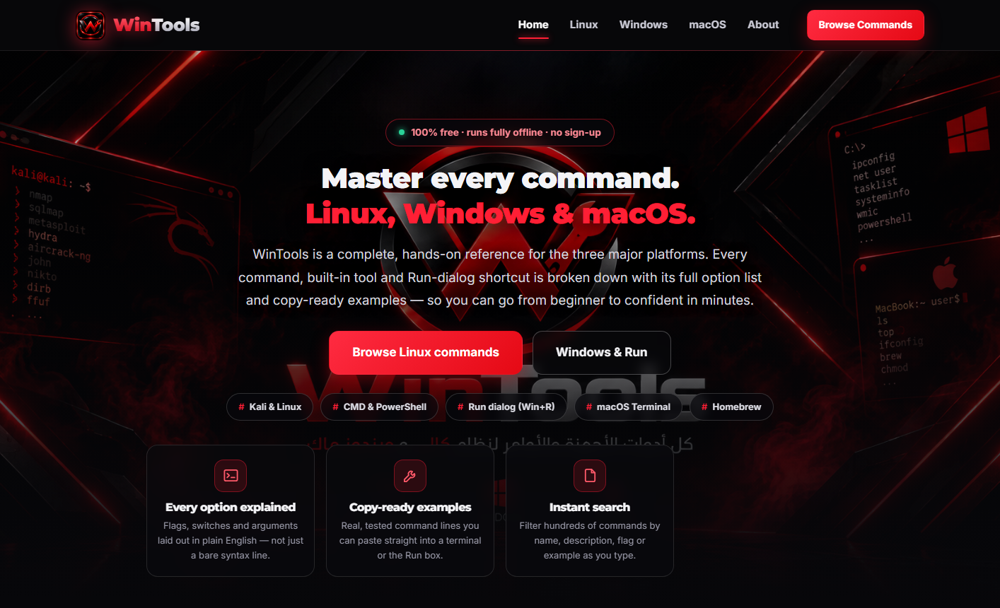
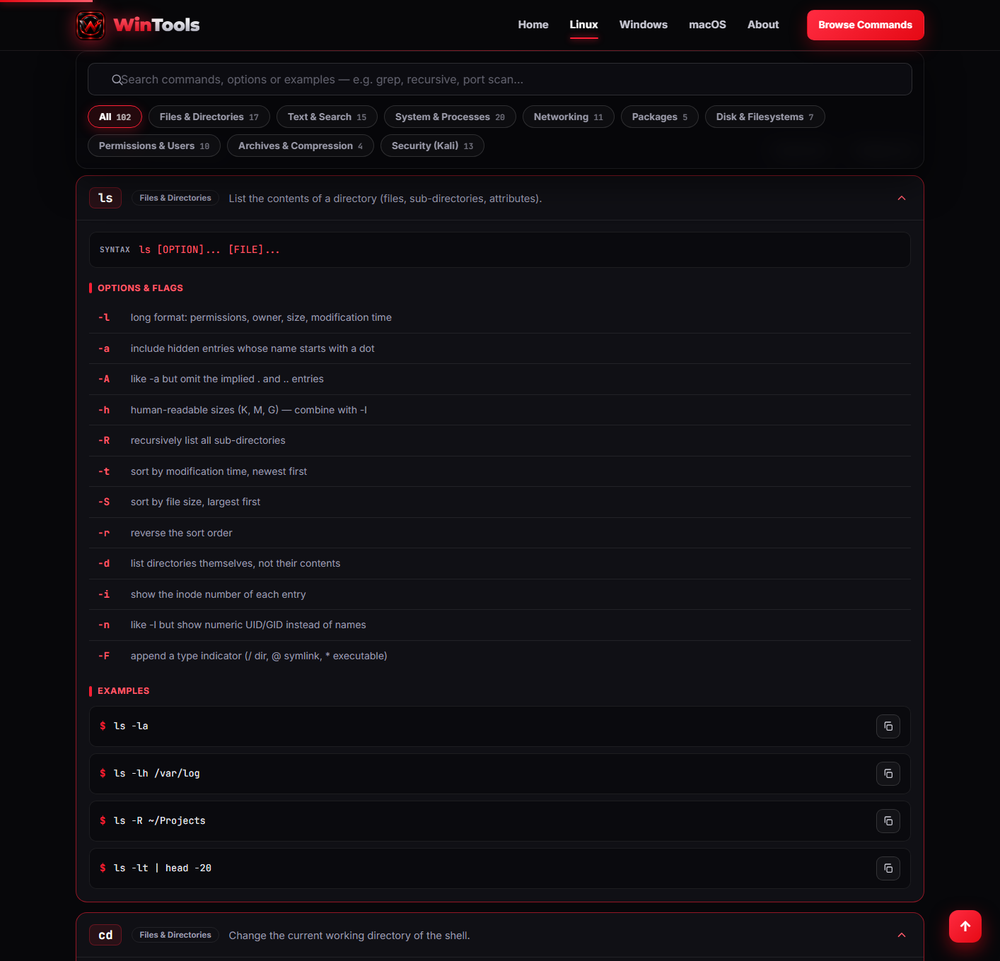
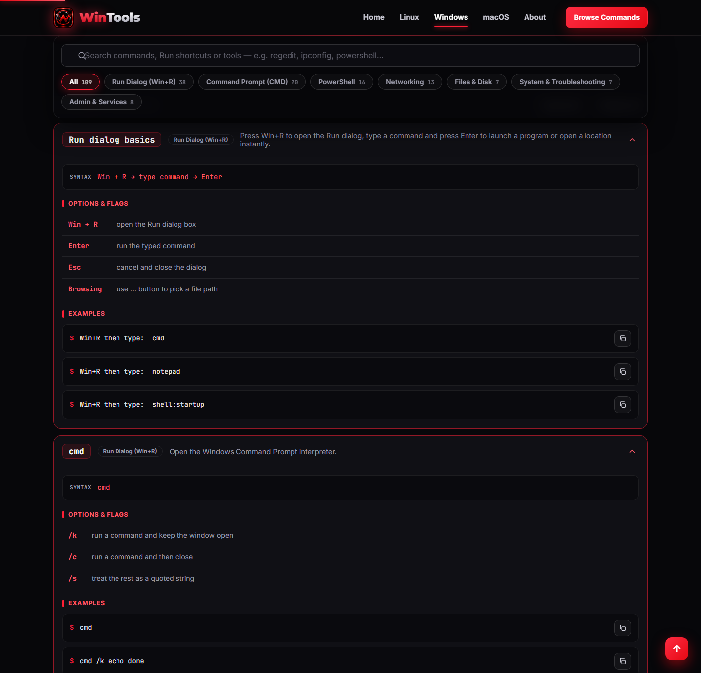
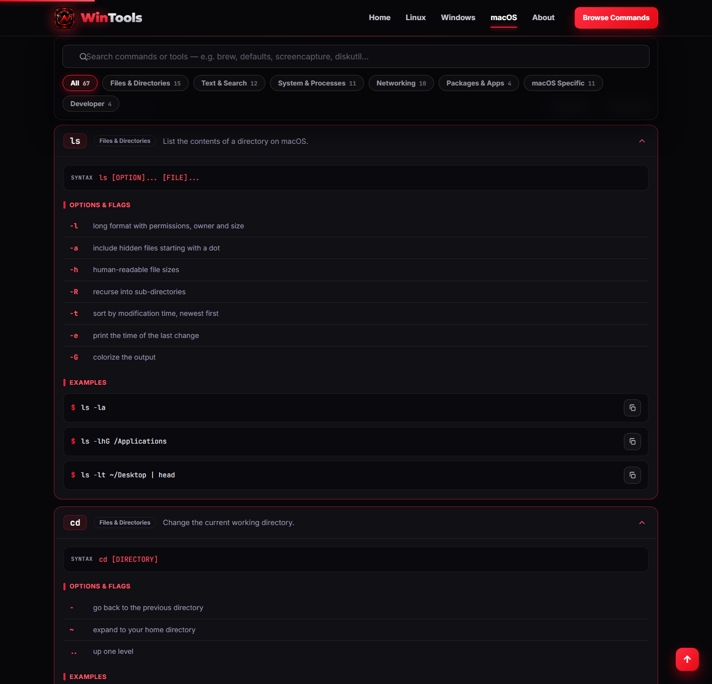
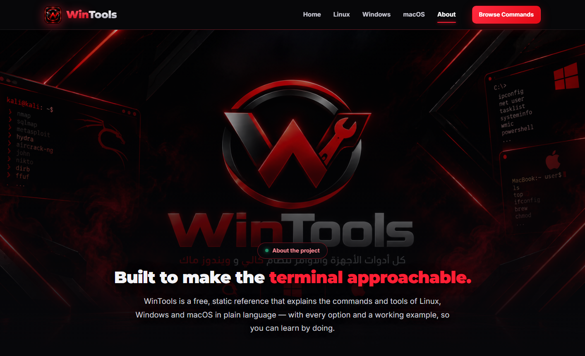

<div align="center">


# WinTools

**A complete, free reference for Linux, Windows & macOS — commands, tools and Run shortcuts explained in detail.**

[](LICENSE)
[](#-what-is-wintools)
[](#-coverage--scope)
[](#-how-it-works)
[](#-privacy)

*Search hundreds of commands, expand any entry to see every option and flag, and copy ready-to-run examples straight to your clipboard — right from your browser.*

[**Live demo**](#-getting-started) · [**Linux & Kali**](linux.html) · [**Windows**](windows.html) · [**macOS**](macos.html) · [**About**](about.html)

</div>

---

## 📖 Table of contents

- [What is WinTools?](#-what-is-wintools)
- [Highlights](#-highlights)
- [Screenshots](#-screenshots)
- [Coverage & scope](#-coverage--scope)
- [How it works](#-how-it-works)
- [Getting started](#-getting-started)
- [Project structure](#-project-structure)
- [Search & filters](#-search--filters)
- [Browser support](#-browser-support)
- [Testing & validation](#-testing--validation)
- [Roadmap](#-roadmap)
- [Privacy](#-privacy)
- [Safety notice](#-safety-notice)
- [Contributing](#-contributing)
- [License](#-license)
- [Developer](#-developer)

---

## 🐧 Windows 🍎 What is WinTools?

**WinTools** is a static, offline-friendly website that documents the commands and built-in tools of the three major desktop platforms:

- **Linux & Kali** — shell essentials, permissions, packages, networking and the security tools that make Kali famous.
- **Windows** — dozens of **Run-dialog (Win+R)** shortcuts, the full **CMD** and **PowerShell** toolkits, plus the built-in GUI admin tools.
- **macOS** — Terminal basics, `defaults` tweaks, Homebrew, Time Machine, Disk Utility and the developer toolchain.

Every entry is written for humans: a one-line description, the canonical **syntax**, a table of **every option and flag**, and **copy-ready examples** you can paste straight into a terminal or the Run box. The whole site runs entirely in your browser — there is **no backend, no build step, no sign-up and no tracking**.

> Built with plain **HTML + CSS + vanilla JavaScript** — no framework, no dependencies. It loads fast, works offline after the first visit, and respects your privacy.

---

## ✨ Highlights

- 🔍 **Instant search** — filter by command name, description, flag or example as you type.
- 🏷️ **Category filters** — jump straight to Files, Networking, Packages, Security, Run dialog, PowerShell, and more.
- 🧩 **Expandable cards** — open any command to reveal its full option table, key controls and examples.
- 📋 **One-click copy** — every example has a copy button that writes to your clipboard.
- 📱 **Fully responsive** — works on desktop, tablet and phone; touch-friendly.
- ⚡ **Zero dependencies** — vanilla JS, no libraries, no frameworks, no build tooling.
- 🌐 **100% offline** — once loaded, everything works without a network connection.
- 🎨 **Professional dark theme** — a red-on-black design that is easy on the eyes.

---

## 📸 Screenshots

| Home | Linux & Kali |
|:---:|:---:|
|  |  |

| Windows (Run + CMD + PowerShell) | macOS |
|:---:|:---:|
|  |  |

| About |
|:---:|
|  |

---

## 🗂️ Coverage & scope

**278 commands and tools** across **3 platforms**, grouped into clear categories.

### 🐧 Linux & Kali — 102 commands
| Category | Count | Examples |
|---|---:|---|
| Files & Directories | 17 | `ls` `cd` `cp` `mv` `rm` `mkdir` `ln` `tree` `stat` `du` |
| Text & Search | 15 | `grep` `find` `sed` `awk` `sort` `uniq` `wc` `cut` `tr` `diff` `tee` `xargs` |
| System & Processes | 20 | `ps` `top` `htop` `kill` `systemctl` `journalctl` `free` `uname` `env` `history` |
| Networking | 11 | `ip` `ping` `ss` `netstat` `curl` `wget` `ssh` `scp` `rsync` `dig` `traceroute` |
| Packages | 5 | `apt` `dpkg` `snap` `dnf` `pacman` |
| Disk & Filesystems | 7 | `df` `mount` `umount` `fdisk` `lsblk` `mkfs` `sync` |
| Permissions & Users | 10 | `chmod` `chown` `useradd` `usermod` `passwd` `sudo` `su` `id` `visudo` |
| Archives & Compression | 4 | `tar` `gzip` `zip` `zcat` |
| **Security (Kali)** | 13 | `nmap` `hydra` `john` `hashcat` `nikto` `sqlmap` `aircrack-ng` `metasploit` `tshark` `openssl` `ssh-keygen` `ufw` `iptables` |

### 🪟 Windows — 109 commands & tools
| Category | Count | Examples |
|---|---:|---|
| **Run Dialog (Win+R)** | 38 | `cmd` `powershell` `regedit` `services.msc` `taskmgr` `msconfig` `devmgmt.msc` `diskmgmt.msc` `gpedit.msc` `shell:startup` `mstsc` `dxdiag` `winver` |
| Command Prompt (CMD) | 20 | `dir` `copy` `xcopy` `robocopy` `del` `findstr` `tasklist` `taskkill` `set`/`setx` `wmic` |
| PowerShell | 16 | `Get-Process` `Get-Service` `Get-ChildItem` `Get-Content` `Select-String` `Where-Object` `ForEach-Object` `Invoke-RestMethod` `Start-Process` |
| Networking | 13 | `ipconfig` `ping` `tracert` `pathping` `netstat` `nslookup` `getmac` `arp` `route` `netsh` `net` |
| Files & Disk | 7 | `chkdsk` `diskpart` `format` `sfc` `DISM` `powercfg` |
| System & Troubleshooting | 7 | Task Manager, Event Viewer, `msconfig` clean boot, Safe Mode, System Restore, Windows Update, `bcdedit` |
| Admin & Services | 8 | `sc` `schtasks` `icacls` `takeown` `net user` `gpupdate`/`gpresult` `winrm` |

### 🍎 macOS — 67 commands & tools
| Category | Count | Examples |
|---|---:|---|
| Files & Directories | 15 | `ls` `cd` `cp` `mv` `rm` `open` `ln` `stat` `du` `head`/`tail` |
| Text & Search | 12 | `grep` `find` `sed` `awk` `sort`/`uniq`/`wc` `cut`/`tr` `diff` `mdfind` `pbcopy`/`pbpaste` |
| System & Processes | 11 | `ps` `top` `kill` `uname` `sw_vers` `system_profiler` `df`/`du` `lsof` `launchctl` |
| Networking | 10 | `ping` `ifconfig` `netstat` `lsof -i` `curl` `dig` `networksetup` `ssh`/`scp` `rsync` |
| Packages & Apps | 4 | `brew` `mas` `xcode-select` `softwareupdate` |
| macOS Specific | 11 | `defaults` `screencapture` `say` `caffeinate` `osascript` `tmutil` `diskutil` `plutil` `sips` `qlmanage` Finder/Dock tweaks |
| Developer | 4 | `git` `python3`/`node` `xcrun` Homebrew best practices |

---

## ⚙️ How it works

WinTools is a **static site** — the kind you can host on GitHub Pages, Netlify, Vercel or any web server (or even open straight from disk).

- **`assets/js/data/*.js`** hold the entire command database as plain JavaScript arrays. Each entry is a small object:

  ```js
  {
    cmd: 'grep',
    cat: 'text',                       // maps to a category chip
    desc: 'Search input for lines matching a pattern.',
    syntax: 'grep [OPTION]... PATTERN [FILE]...',
    opts: [ ['-i', 'ignore case'], ['-r', 'search recursively'], ... ],
    examples: [ 'grep -rn "TODO" src/', ... ]
  }
  ```

- **`assets/js/browser.js`** turns any dataset into a searchable, filterable, expandable list. It reads the `data`/`cats` arrays, renders a card per command, and wires up search, category chips, expand-all / collapse-all and copy buttons.

- **`assets/js/chrome.js`** injects the shared header, footer and navigation, plus small UI helpers (icons, toasts, clipboard).

- **`assets/js/pages/os.js`** is a tiny launcher used by all three OS pages — it detects the current page from its filename and mounts the matching dataset. Adding a new platform is just one data file + one HTML page.

Because everything is client-side, the site keeps working with **no internet connection** after the first load, and **nothing you type ever leaves your device**.

---

## 🚀 Getting started

### Option 1 — Just open it (fastest)

Download or clone the repository, then double-click **`index.html`**. It works straight from `file://` — no server required.

### Option 2 — Run a local server (recommended for development)

Any static server works. With Python installed:

```bash
# from the project root
python tests/serve.py          # then open http://localhost:8767/
```

or with Node.js:

```bash
npx serve .
```

### Option 3 — Deploy to the web

Push the folder to GitHub and enable **GitHub Pages** (Settings → Pages → Deploy from branch → `main` / root), or drag-and-drop the folder onto [Netlify](https://netlify.com) or [Vercel](https://vercel.com). There is **no build step** — publish the files as-is.

> **Tip:** the whole project is a plain folder of files. To update a command, edit the relevant `assets/js/data/<platform>.js` and refresh — no compile, no bundler.

---

## 📁 Project structure

```
WinTools/
├── index.html                     # Home — hero, stats, platform cards, how-to, FAQ
├── linux.html                     # Linux & Kali command library
├── windows.html                   # Windows: Run dialog, CMD, PowerShell, admin
├── macos.html                     # macOS Terminal, defaults, Homebrew, dev tools
├── about.html                     # About, coverage, safety notice, developer
│
├── assets/
│   ├── css/
│   │   └── style.css              # Full design system (red/black dark theme)
│   ├── img/
│   │   ├── background.png         # Hero background (branded)
│   │   ├── logo.png               # WinTools wordmark logo
│   │   ├── icon.png               # App icon (source)
│   │   ├── icon-192.png           # PWA icon
│   │   ├── icon-512.png           # PWA icon (maskable)
│   │   ├── favicon.png            # Root favicon (64×64)
│   │   ├── favicon-32x32.png      # Small favicon variant
│   │   └── apple-touch-icon.png   # iOS home-screen icon
│   └── js/
│       ├── utils.js               # Encoding, download & clipboard helpers
│       ├── chrome.js              # Header, footer, nav, icons, toasts, copy
│       ├── browser.js             # Search / filter / expandable command cards
│       ├── data/
│       │   ├── linux.js           # 102 Linux & Kali commands
│       │   ├── windows.js         # 109 Windows commands & tools
│       │   └── macos.js           # 67 macOS commands & tools
│       └── pages/
│           ├── home.js            # Home-page stat counters
│           └── os.js              # Shared launcher for the 3 OS pages
│
├── docs/                          # README screenshots
├── tests/
│   ├── serve.py                   # No-cache local dev server (port 8767)
│   ├── validate.py                # Static audit: refs, icons, DOM wiring, JS balance, data
│   └── screenshots.py             # Captures docs/ screenshots (Selenium + Edge)
├── favicon.png                    # Root favicon
├── apple-touch-icon.png
├── site.webmanifest               # PWA manifest
├── robots.txt
├── sitemap.xml
├── LICENSE                        # MIT
└── README.md
```

---

## 🔎 Search & filters

- **Search box** — type anything: a command (`grep`), a task (`recursive`), a flag (`--dport`) or part of an example (`/var/log`). Results update instantly.
- **Category chips** — click a chip (e.g. *Security (Kali)*, *Run Dialog*, *PowerShell*) to narrow the list. The **All** chip shows everything.
- **Live counter** — “Showing **N** of 278 commands” updates as you filter.
- **Expand / Collapse all** — open every card at once to skim, or close them all.
- **Copy buttons** — one tap copies any example to the clipboard (with a fallback for older browsers).

---

## 🌍 Browser support

WinTools uses only widely supported, modern web APIs (ES5-compatible code, `IntersectionObserver`, the Clipboard API with a fallback). It runs on:

| Browser | Supported |
|---|:---:|
| Chrome / Edge (last 2 years) | ✅ |
| Firefox (last 2 years) | ✅ |
| Safari (macOS & iOS) | ✅ |
| Older browsers | Graceful (icons, copy use fallbacks) |

Because it is plain HTML/CSS/JS with **no modules or `fetch`**, it also works when opened directly from the filesystem (`file://`).

---

## 🧪 Testing & validation

The project ships with a lightweight validation harness (no test framework needed):

```bash
python tests/validate.py      # static audit
```

The audit checks, across the whole project:

- every local `src` / `href` reference resolves to a real file;
- every `data-icon="…"` used in HTML is defined in `chrome.js`;
- the DOM `id`s the page scripts rely on (`…List`, `…Count`, `…Search`, `…Chips`, `…Expand`, `…Collapse`) actually exist on each page;
- every JS file is free of unbalanced brackets / unterminated strings / comments (a small string-, comment- and regex-aware lexer);
- every command entry has its `desc`, `syntax`, `opts` and `examples`, and its `cat` maps to a declared category;
- no stray non-English characters leaked into the English content.

Latest run:

```
linux:   102 commands   (files 17, text 15, system 20, net 11, pkg 5, disk 7, perm 10, archive 4, sec 13)
windows: 109 commands   (run 38, cmd 20, ps 16, net 13, files 7, sys 7, admin 8)
macos:    67 commands   (files 15, text 12, system 11, net 10, pkg 4, mac 11, dev 4)
TOTAL:   278 commands across 3 platforms
Problems: none — all checks passed
```

To regenerate the screenshots used above (requires Selenium + Microsoft Edge):

```bash
python tests/screenshots.py
```

---

## 🗺️ Roadmap

- [ ] Add a **favourites / recently-viewed** panel (stored locally in `localStorage`).
- [ ] Add **print / export to PDF** for a filtered set of commands.
- [ ] Add **dark / light theme** toggle.
- [ ] Expand the **Security (Kali)** section with more Nmap/Metasploit recipes.
- [ ] Add a **PowerShell vs CMD** comparison page.
- [ ] Add **command quiz / flashcards** mode for learning.
- [ ] Localise the interface into more languages.

Contributions and ideas are welcome — see [Contributing](#-contributing).

---

## 🔒 Privacy

WinTools sends **nothing** to any server. There is:

- ❌ no backend / API
- ❌ no analytics or tracking
- ❌ no cookies
- ❌ no accounts or sign-up
- ❌ no uploads

Your search terms, your clipboard and your usage all stay on your device. You can even disconnect from the internet after the first load and keep using the whole site.

---

## ⚠️ Safety notice

Some commands can **permanently delete data**, overwrite disks or change how a system behaves. Examples include `rm -rf`, `mkfs` and `dd` on Linux/macOS, and `diskpart`, `format` and `clean` on Windows. Security tools such as `nmap`, `hydra`, `sqlmap` and `Metasploit` are intended **only** for systems you own or are explicitly authorised to test.

**Always** read the full option list before running a command, prefer a non-destructive flag first, back up important data, and practise in a virtual machine or on test data while learning. The examples here are for education — **you** are responsible for how you use them.

---

## 🤝 Contributing

Contributions are welcome — whether it is fixing a typo, correcting a flag, or adding commands for a new category or platform.

1. **Fork** the repository and create a feature branch (`git checkout -b feat/my-feature`).
2. **Edit** the relevant `assets/js/data/<platform>.js`. Follow the existing entry shape (`cmd`, `cat`, `desc`, `syntax`, `opts`, `examples`).
3. **Run** `python tests/validate.py` to make sure everything still passes.
4. **Commit** with a clear message and **open a Pull Request** describing the change.

Please keep entries accurate, concise and beginner-friendly.

---

## 📄 License

Released under the [MIT License](LICENSE).

```
MIT License

Copyright (c) 2026 Rakan Almoliki

Permission is hereby granted, free of charge, to any person obtaining a copy
of this software and associated documentation files (the "Software"), to deal
in the Software without restriction, including without limitation the rights
to use, copy, modify, merge, publish, distribute, sublicense, and/or sell
copies of the Software, and to permit persons to whom the Software is
furnished to do so, subject to the following conditions:

The above copyright notice and this permission notice shall be included in all
copies or substantial portions of the Software.

THE SOFTWARE IS PROVIDED "AS IS", WITHOUT WARRANTY OF ANY KIND, EXPRESS OR
IMPLIED, INCLUDING BUT NOT LIMITED TO THE WARRANTIES OF MERCHANTABILITY,
FITNESS FOR A PARTICULAR PURPOSE AND NONINFRINGEMENT. IN NO EVENT SHALL THE
AUTHORS OR COPYRIGHT HOLDERS BE LIABLE FOR ANY CLAIM, DAMAGES OR OTHER
LIABILITY, WHETHER IN AN ACTION OF CONTRACT, TORT OR OTHERWISE, ARISING FROM,
OUT OF OR IN CONNECTION WITH THE SOFTWARE OR THE USE OR OTHER DEALINGS IN THE
SOFTWARE.
```

---

## 👨‍💻 Developer

Designed & developed with care by **Rakan Almoliki**.

- **GitHub:** [github.com/451646464](https://github.com/451646464)
- **Email:** rakanalmoliki33@gmail.com

If WinTools helped you learn something, give the project a ⭐ on GitHub — it really helps others find it.

---

<div align="center">
<i>Made with a terminal open and a dark theme on. © 2026 WinTools — All rights reserved.</i>
</div>
